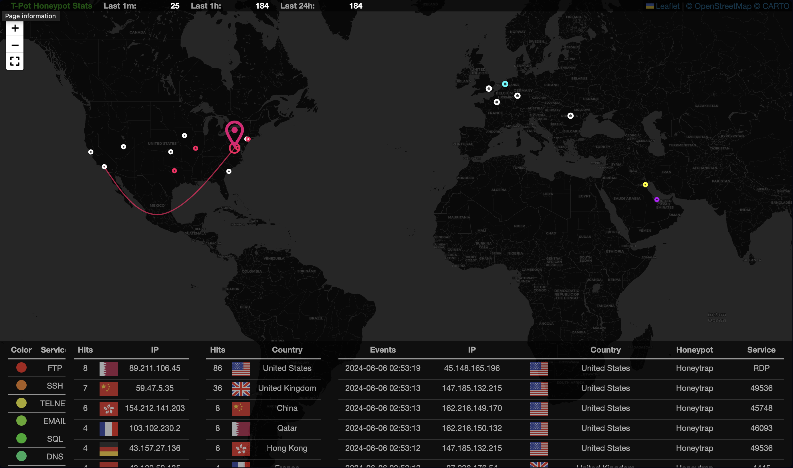

# Azure SEIM Lab
---
This repository contains Terraform code to set up an Azure honeypot environment for Security Information and Event Management (SIEM) lab purposes. The code provisions an Ubuntu virtual machine with various open ports to simulate a vulnerable system and attract potential attackers. [video guide](https://www.youtube.com/watch?v=WRB1-Lp6A8w)

## Prerequisites
---
- Azure subscription
- Terraform installed
- Azure CLI installed
- SSH key pair (public and private keys)

## Usage
---
1. Clone this repository:


2. Navigate to the repository directory:


3. Copy your SSH public key to the `~/.ssh/id_rsa.pub` path or update the `public_key` line in `main.tf` with the path to your public key.

4. Run `terraform init` to initialize the Terraform working directory.

5. Run `terraform apply` to create the Azure resources. Review the execution plan and enter `yes` to confirm.

6. After the deployment is complete, Terraform will output the public IP address and SSH command to connect to the virtual machine. **The VM then installs T-Pot automatically via cloud-init** — see [Accessing the Lab](#accessing-the-lab) below.

## Accessing the Lab
---

Provisioning is fully automatic. On first boot, cloud-init installs T-Pot CE
(~15–30 min), then the machine **reboots itself** to finish. Watch progress
from another shell:

```
ssh azureuser@<vm_ip> 'tail -f /var/log/tpot-bootstrap.log'
```

Once it has rebooted, get the connection details from Terraform:

```
terraform output
```

- **T-Pot web UI (landing page):** `https://<vm_ip>:64297`
  - Username `azureuser` / Password `hellohoney`
    (set by the `admin_username` and `admin_password` variables)
- **SSH (after T-Pot moves it off port 22):** `ssh -p 64295 azureuser@<vm_ip>`

> T-Pot relocates SSH from `22` to `64295` and takes over the firewall. Before
> the install finishes, plain `ssh azureuser@<vm_ip>` (port 22) still works.

## Keeping T-Pot Current
---

- `terraform apply` runs `git clone` on branch `master` **at provision time**, so
  a fresh deployment always installs the latest T-Pot. It is **not pinned** — for
  a reproducible build, set `tpot_branch` to a release tag:
  `terraform apply -var 'tpot_branch=24.04.1'`.
- To **update a sensor that is already running**, use T-Pot's own updater:
  ```
  ssh -p 64295 azureuser@<vm_ip>
  cd ~/tpotce
  curl -fsSL -o update.sh https://raw.githubusercontent.com/telekom-security/tpotce/master/update.sh
  chmod +x update.sh && ./update.sh -y -b master
  ```
- The installer runs **unattended** via `./install.sh -s -t h -u <user> -p <pass>`
  (see [`cloud-init/tpot.yaml`](cloud-init/tpot.yaml)) rather than piping answers
  to interactive prompts, which change between T-Pot releases.

## SOC Layer (Wazuh SIEM + Sentinel playbooks)
---

The [`soc/`](soc/) directory extends this honeypot into a working SOC:

- **Wazuh** SIEM/XDR on a separate, locked-down VM — ingests the T-Pot logs,
  detects (brute force, malware, Suricata, multi-honeypot correlation), opens a
  ticket per alert, and blocks attacker IPs in the honeypot NSG via Active Response.
- **Microsoft Sentinel** playbooks (Logic Apps) for SOAR — incident-triggered
  remediation, wired with automation rules.

See [`soc/README.md`](soc/README.md) for the architecture and deploy order.

> **Cost note:** Sentinel bills **per GB ingested**. Never ship raw honeypot logs
> to Sentinel — forward Wazuh *alerts* only.

--- 


## Cleanup
---
To remove all the created resources, run `terraform destroy` and confirm by entering `yes`.

## Security Considerations
---
This lab environment is designed to simulate a vulnerable system and attract potential attackers for educational purposes. It is recommended to use this setup in a controlled environment and not expose it to the public internet. Additionally, ensure to clean up the resources after completing the lab to avoid any potential misuse.

## License
---
This project is licensed under the [MIT License](LICENSE).
